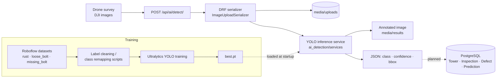

# APTRANSCO AI Drone Inspection — Transmission-Line Defect Detection

> A Django REST backend that runs custom-trained YOLO models on drone images of power transmission towers and returns the defects it finds as structured JSON with bounding boxes. Built during my AI/ML internship at **APTRANSCO** (Andhra Pradesh Transmission Corporation).

[](#)
[](#)
[](#)
[](#)
[](#)

| | |
|---|---|
| **Production system** | **[drone.aptransco.co.in](https://drone.aptransco.co.in/)**: adopted by APTRANSCO and running on its production servers (staff sign-in required). |
| **This repository** | The **early backend and training-data pipeline** (May 2026) that the production system grew out of. The production code base and the trained weights belong to APTRANSCO and are not published here. |
| **Team** | Built by a team of 3 engineers at the APTRANSCO IT Wing. My part: training the custom YOLO detection models and building the modular DRF inference pipelines. |

---

## Problem

APTRANSCO maintains thousands of kilometres of high-voltage lines. Linemen inspect towers by eye, and drone surveys bring back thousands of high-resolution images per line that someone then has to review by hand. Corrosion, loose bolts and missing bolts are easy to miss, and the findings end up in spreadsheets instead of a searchable maintenance record.

## Solution

- **Detection API**: upload a drone image and get back each defect's class, confidence and bounding box, plus an annotated result image.
- **Custom YOLO models** trained on APTRANSCO drone imagery (DJI) for transmission-line defect classes, built from several Roboflow-labelled datasets.
- **Asset data model** for `Tower`, `Inspection`, `Defect` (severity Low → Critical) and `Prediction` (failure risk and probability), stored in PostgreSQL.
- **Label-cleaning scripts** that merge and remap classes across datasets before training (for example, dropping `tower_main_body` and folding `severe_corrosion` into `rust`).

Results reported for the production models: **92% mAP** across multiple defect categories, and **~40% lower end-to-end processing latency** after the inference path was moved into modular DRF pipelines.

## Architecture



## Tech stack

| Layer | Technology |
|---|---|
| API | Django 6, Django REST Framework |
| ML | Ultralytics YOLO, PyTorch, OpenCV |
| Data | PostgreSQL (`psycopg2`) |
| Labelling | Roboflow (YOLO format) |
| Reports (planned in this snapshot) | ReportLab, Matplotlib |

## Project structure

```
Aptransco-Drone/
├── backend/                 # Django project settings & URL routing
├── ai_detection/            # Detection API
│   ├── services/yolo26_detector.py   # model loading + inference + annotation
│   ├── serializers.py       # upload validation
│   └── views.py             # POST /api/ai/detect/
├── analytics_engine/        # Tower / Inspection / Defect / Prediction models
├── dashboard/               # Landing page
├── reports/                 # Reporting app (scaffold)
├── clean_rust_labels.py     # Dataset label cleaning & class remapping
├── clean_rust2_labels.py
├── convert_bolt_labels.py
├── convert_rust_to_class1.py
└── requirements.txt
```

## Getting started

```bash
git clone https://github.com/karrisubhash/Aptransco-Drone.git
cd Aptransco-Drone
python -m venv .venv && source .venv/bin/activate   # Windows: .venv\Scripts\activate
pip install -r requirements.txt

cp .env.example .env          # set DB credentials and a secret key
createdb aptransco_ai_db
python manage.py migrate
mkdir -p media/uploads media/results

# Point YOLO_WEIGHTS in .env at your trained weights (weights are not distributed)
python manage.py runserver
```

### Environment variables

Settings are read from `.env` (loaded with python-dotenv); see [`.env.example`](.env.example).

| Variable | Purpose |
|---|---|
| `DJANGO_SECRET_KEY` | Django secret key (required outside development) |
| `DJANGO_DEBUG` | `True` for local development only |
| `DJANGO_ALLOWED_HOSTS` | Comma-separated host names |
| `DB_NAME`, `DB_USER`, `DB_PASSWORD`, `DB_HOST`, `DB_PORT` | PostgreSQL connection |
| `YOLO_WEIGHTS` | Path to the trained `.pt` file |

## API

### `POST /api/ai/detect/`

`multipart/form-data` with an `image` field.

```bash
curl -F "image=@tower_0042.jpg" http://127.0.0.1:8000/api/ai/detect/
```

```json
{
  "status": "success",
  "results": {
    "detections": [
      { "class_name": "rust", "confidence": 0.87, "bounding_box": [412, 220, 618, 391] }
    ],
    "result_image": "media/results/tower_0042.jpg"
  }
}
```

## Training the detector

1. Export each Roboflow dataset in **YOLOv8 format** into `temp_<dataset>/` (`train/valid/test` + `data.yaml`).
2. Normalise the classes with the cleaning scripts, e.g. `python clean_rust_labels.py`.
3. Train:
   ```bash
   yolo detect train data=temp_rust_1/data.yaml model=<pretrained-yolo-weights>.pt
   ```
4. Copy `runs/detect/<run>/weights/best.pt` to the path in `YOLO_WEIGHTS`.

## Screenshots

<!-- TODO(Subhash): add 2–3 images that APTRANSCO has cleared for publication, e.g.

 -->

## Testing

```bash
python manage.py test
```

Not covered yet: there are no automated tests in this snapshot. See *Future improvements*.

## Future improvements

- Load the model lazily so the app starts without weights.
- Persist every detection as `Inspection` / `Defect` rows instead of returning JSON only.
- Add API tests with a tiny fixture model, plus an evaluation script that reports mAP@0.5 and mAP@0.5:0.95 per class.
- Move inference to a Celery worker so large survey batches don't block the request cycle.
- Publish a model card (dataset size, classes, metrics, known failure modes).

## Acknowledgements

Built at the **APTRANSCO IT Wing** with my two teammates. Drone imagery and production weights are APTRANSCO property and are not included in this repository.
